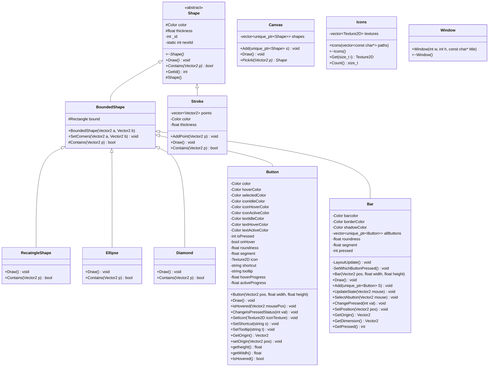

# Classes & Inheritance Hierarchy

This document provides an exhaustive structural and architectural reference for every class in Inkling. The codebase is organized around a polymorphic class hierarchy rooted in an abstract `Shape` base class, extended into 2D geometric shapes via `BoundedShape`, freehand polylines via `Stroke`, and even GUI components (`Bar` and `Button`). Below, we break down every class's inheritance, member variables, virtual function contracts, access levels, and file locations, supplemented by an architectural Mermaid class diagram.

## Related Files
- Base Interfaces: [include/Shape.h](file:///home/subhani/Projects/Inkling/include/Shape.h), [src/Shape.cpp](file:///home/subhani/Projects/Inkling/src/Shape.cpp)
- Geometric Bounds: [include/BoundedShape.h](file:///home/subhani/Projects/Inkling/include/BoundedShape.h), [src/BoundedShape.cpp](file:///home/subhani/Projects/Inkling/src/BoundedShape.cpp)
- Shape Primitives: [include/RectangleShape.h](file:///home/subhani/Projects/Inkling/include/RectangleShape.h), [include/Ellipse.h](file:///home/subhani/Projects/Inkling/include/Ellipse.h), [include/Diamond.h](file:///home/subhani/Projects/Inkling/include/Diamond.h), [include/Stroke.h](file:///home/subhani/Projects/Inkling/include/Stroke.h)
- Storage & Factory: [include/Canvas.h](file:///home/subhani/Projects/Inkling/include/Canvas.h), [include/ShapeFactory.h](file:///home/subhani/Projects/Inkling/include/ShapeFactory.h)
- UI Components: [include/Bar.h](file:///home/subhani/Projects/Inkling/include/Bar.h), [include/Button.h](file:///home/subhani/Projects/Inkling/include/Button.h), [include/Icons.h](file:///home/subhani/Projects/Inkling/include/Icons.h), [include/window.h](file:///home/subhani/Projects/Inkling/include/window.h)

---

## 1. Inheritance Diagram

The following Mermaid diagram visualizes the complete class hierarchy:



---

## 2. Detailed Class Catalog

### 2.1 `Shape`
- **Declared in**: [include/Shape.h](file:///home/subhani/Projects/Inkling/include/Shape.h#L4-L24)
- **Defined in**: [src/Shape.cpp](file:///home/subhani/Projects/Inkling/src/Shape.cpp#L1-L3)
- **Base Class**: None (root base class).
- **Purpose**: Defines the abstract contract for any drawable and hit-testable canvas element. Enforces runtime polymorphism via its vtable.
- **Member Variables**:
  - `Color color = WHITE;` (protected): Default stroke color for the shape.
  - `float thickness = 2;` (protected): Default stroke outline thickness in pixels.
  - `int _id;` (private): Unique sequential integer ID assigned to every shape instance.
  - `static int nextId;` (private static): Monotonically increasing counter initialized to `0` in `src/Shape.cpp`.
- **Public Interface**:
  - `virtual ~Shape() = default;`: Virtual destructor ensuring derived destructors are called when deleted through a base `Shape*`.
  - `virtual void Draw() const = 0;`: **Pure virtual**. Polymorphic rendering routine.
  - `virtual bool Contains(Vector2 p) const = 0;`: **Pure virtual**. Polymorphic geometric point containment test.
  - `int GetId() const`: Accessor returning the instance's unique ID `_id`.
- **Protected Interface**:
  - `Shape();`: Protected default constructor. Automatically assigns `_id(nextId++)`. Can only be invoked by derived class constructors.

---

### 2.2 `BoundedShape`
- **Declared in**: [include/BoundedShape.h](file:///home/subhani/Projects/Inkling/include/BoundedShape.h#L4-L12)
- **Defined in**: [src/BoundedShape.cpp](file:///home/subhani/Projects/Inkling/src/BoundedShape.cpp#L1-L14)
- **Base Class**: `public Shape`
- **Purpose**: Intermediate base class for any shape whose geometry is enclosed within a 2D axis-aligned bounding box (`Rectangle bound`).
- **Member Variables**:
  - `Rectangle bound;` (protected): Raylib structure `{float x, float y, float width, float height}` representing top-left coordinates and dimensions.
- **Public Interface**:
  - `BoundedShape(Vector2 a, Vector2 b);`: Constructor taking two diagonal points. Calls `SetCorners(a, b)`.
  - `void SetCorners(Vector2 a, Vector2 b);`: Normalizes diagonal points `a` and `b` into positive dimensions:
    ```cpp
    bound = {std::min(a.x, b.x), std::min(a.y, b.y), std::fabs(b.x - a.x), std::fabs(b.y - a.y)};
    ```
- **Virtual / Overridden Functions**:
  - `bool Contains(Vector2 p) const override;`: Overrides `Shape::Contains`. Tests if `p` falls within `bound` using raylib's `CheckCollisionPointRec(p, bound)`.
  - *Note on Access Specifier*: Declared under `protected:` in `BoundedShape.h`, though declared `public:` in `Shape.h`.

---

### 2.3 `RecatngleShape`
- **Declared in**: [include/RectangleShape.h](file:///home/subhani/Projects/Inkling/include/RectangleShape.h#L4-L9)
- **Defined in**: [src/RectangleShape.cpp](file:///home/subhani/Projects/Inkling/src/RectangleShape.cpp#L1-L8)
- **Base Class**: `public BoundedShape`
- **Purpose**: Concrete shape representing a rectangular outline.
- **Identifier Note**: Named `RecatngleShape` (typographical omission of 'n' before 'g') in both declaration and definition.
- **Public Interface & Constructors**:
  - `using BoundedShape::BoundedShape;`: Inherits constructors from `BoundedShape(Vector2 a, Vector2 b)`.
- **Virtual / Overridden Functions**:
  - `void Draw() const override;`: Renders rectangle outline via `DrawRectangleLinesEx(bound, thickness, color);`.
  - `bool Contains(Vector2 p) const override;`: Calls `CheckCollisionPointRec(p, bound);`.

---

### 2.4 `Ellipse`
- **Declared in**: [include/Ellipse.h](file:///home/subhani/Projects/Inkling/include/Ellipse.h#L4-L9)
- **Defined in**: [src/Ellipse.cpp](file:///home/subhani/Projects/Inkling/src/Ellipse.cpp#L1-L16)
- **Base Class**: `public BoundedShape`
- **Purpose**: Concrete shape representing an elliptical outline inscribed inside `bound`.
- **Public Interface & Constructors**:
  - `using BoundedShape::BoundedShape;`: Inherits `BoundedShape` constructors.
- **Virtual / Overridden Functions**:
  - `void Draw() const override;`: Calls `DrawEllipseLines((int)(bound.x + bound.width / 2), (int)(bound.y + bound.height / 2), bound.width / 2, bound.height / 2, color);`.
  - `bool Contains(Vector2 p) const override;`: Overrides hit testing with an exact algebraic normalized distance test:
    $$\left(\frac{p.x - h}{r_x}\right)^2 + \left(\frac{p.y - k}{r_y}\right)^2 \le 1.0$$

---

### 2.5 `Diamond`
- **Declared in**: [include/Diamond.h](file:///home/subhani/Projects/Inkling/include/Diamond.h#L4-L9)
- **Defined in**: [src/Diamond.cpp](file:///home/subhani/Projects/Inkling/src/Diamond.cpp#L1-L24)
- **Base Class**: `public BoundedShape`
- **Purpose**: Concrete shape representing a rhombus/diamond formed by connecting the midpoints of the four edges of `bound`.
- **Public Interface & Constructors**:
  - `using BoundedShape::BoundedShape;`: Inherits `BoundedShape` constructors.
- **Virtual / Overridden Functions**:
  - `void Draw() const override;`: Computes midpoints `top`, `right`, `down`, `left` and draws 4 outline segments with `DrawLineEx`.
  - `bool Contains(Vector2 p) const override;`: Overrides hit testing using normalized Manhattan distance:
    $$\frac{|p.x - h|}{r_x} + \frac{|p.y - k|}{r_y} \le 1.0$$

---

### 2.6 `Stroke`
- **Declared in**: [include/Stroke.h](file:///home/subhani/Projects/Inkling/include/Stroke.h#L5-L15)
- **Defined in**: [src/Stroke.cpp](file:///home/subhani/Projects/Inkling/src/Stroke.cpp#L1-L18)
- **Base Class**: `public Shape` (Direct descendant of `Shape`, not `BoundedShape`).
- **Purpose**: Represents a freehand, multi-segment polyline stroke captured from continuous mouse drags.
- **Member Variables**:
  - `std::vector<Vector2> points;` (private): Ordered collection of sampled mouse vertices.
  - `Color color = WHITE;` (private): Line color (shadows `Shape::color`).
  - `float thickness = 2;` (private): Line thickness in pixels (shadows `Shape::thickness`).
- **Public Interface**:
  - `void AddPoint(Vector2 p);`: Appends a new point to `points`.
- **Virtual / Overridden Functions**:
  - `void Draw() const override;`: Iterates `points` from index 1 to `points.size() - 1` and draws segments via `DrawLineEx(points[i-1], points[i], thickness, color)`.
  - `bool Contains(Vector2 p) const override;`: Calculates distance tolerance `tol = thickness / 2.0f + 4.0f`. Checks collision against single point circle or consecutive line segments via raylib's `CheckCollisionPointLine`.

---

### 2.7 `Button`
- **Declared in**: [include/Button.h](file:///home/subhani/Projects/Inkling/include/Button.h#L6-L55)
- **Defined in**: [src/Button.cpp](file:///home/subhani/Projects/Inkling/src/Button.cpp#L1-L107)
- **Base Class**: `public BoundedShape`
- **Purpose**: Represents an individual toolbar icon button capable of tracking hover and active animations, displaying an icon texture, and rendering a shortcut key label.
- **Member Variables**:
  - `Color color`, `hoverColor`, `selectedColor`: Background states.
  - `Color iconIdleColor`, `iconHoverColor`, `iconActiveColor`: Icon tint states.
  - `Color textIdleColor`, `textHoverColor`, `textActiveColor`: Shortcut font tint states.
  - `int isPressed = 0;`: Selection flag (1 = active/selected, 0 = inactive).
  - `bool onHover = false;`: Mouse hover flag.
  - `float roundness = 0.4545f;`: Raylib rounded rectangle ratio for 10px corner radius.
  - `float segment = 10;`: Corner tessellation subdivisions.
  - `Texture2D icon;`: GPU texture handle for button glyph.
  - `std::string shortcut;`: Single-character shortcut label (e.g., `"R"`).
  - `std::string tooltip;`: Tooltip description (e.g., `"Rectangle - R"`).
  - `float hoverProgress = 0.0f;`: Animation interpolator ($[0.0, 1.0]$) for hover state.
  - `float activeProgress = 0.0f;`: Animation interpolator ($[0.0, 1.0]$) for active state.
- **Public Interface**:
  - `Button(Vector2 pos, float width = 44, float height = 48);`
  - `void ChangeIsPressedStatus(int val);`: Mutates `isPressed`.
  - `void isHovered(Vector2 mousePos);`: Checks mouse collision against `bound` and advances `hoverProgress` / `activeProgress` using frame delta time.
  - `Vector2 GetOrigin() const;` / `void setOrigin(Vector2 pos);`
  - `float getheight() const;` / `float getWitdh() const;` (spelled `getWitdh`)
  - `void SetIcon(Texture2D iconTexture);`
  - `void SetShortcut(const std::string &s);` / `const std::string &GetShortcut() const;`
  - `void SetTooltip(const std::string &t);` / `const std::string &GetTooltip() const;`
  - `bool IsHovered() const;`
- **Virtual / Overridden Functions**:
  - `void Draw() const override;`: Renders animated background via `DrawRectangleRounded`, icon texture via `DrawTexturePro`, and shortcut text via `DrawText`.

---

### 2.8 `Bar`
- **Declared in**: [include/Bar.h](file:///home/subhani/Projects/Inkling/include/Bar.h#L69-L97)
- **Defined in**: [src/bar.cpp](file:///home/subhani/Projects/Inkling/src/bar.cpp#L1-L125)
- **Base Class**: `public BoundedShape`
- **Purpose**: Vertical toolbar container that holds, positions, renders, and manages events for an array of `Button` instances.
- **Member Variables**:
  - `Color barcolor`: Dark background container color.
  - `Color borderColor`: 1px outline color.
  - `Color shadowColor`: Drop shadow color.
  - `std::vector<std::unique_ptr<Button>> allButtons;`: Owns buttons exclusively.
  - `float roundness = 0.4667f;`: Normalized radius for 14px corners.
  - `float segment = 12;`: Segment tessellation count.
  - `int pressed = 2;`: Index of currently active tool (defaults to `2`, `TOOL_RECT`).
- **Private Helper Functions**:
  - `void LayoutUpdate();`: Computes total height and positions each button sequentially with padding and gaps.
  - `void SetWhichButtonPressed();`: Synchronizes `isPressed` state across all owned buttons.
- **Public Interface**:
  - `Bar(Vector2 pos, float width = ..., float height = 0);`
  - `void Add(std::unique_ptr<Button> S);`: Adds a button and triggers `LayoutUpdate()`.
  - `void UpdateState(Vector2 mouse);`: Updates hover status for all buttons and toggles the mouse cursor (`MOUSE_CURSOR_POINTING_HAND`).
  - `void SelectAbutton(Vector2 mouse);`: Performs button hit testing and updates `pressed`.
  - `void ChangePressed(int val);`: Programmatically switches active tool and updates buttons.
  - `void SetPosition(Vector2 pos);`: Repositions the bar and triggers `LayoutUpdate()`.
  - `Vector2 GetOrigin() const;` / `Vector2 GetDimension() const;`
  - `int GetPressed() const;`
- **Virtual / Overridden Functions**:
  - `void Draw() const override;`: Renders shadow, container box, border, all child buttons, and any active tooltip.

---

### 2.9 `Canvas`
- **Declared in**: [include/Canvas.h](file:///home/subhani/Projects/Inkling/include/Canvas.h#L6-L14)
- **Defined in**: [src/Canvas.cpp](file:///home/subhani/Projects/Inkling/src/Canvas.cpp#L1-L13)
- **Base Class**: None.
- **Purpose**: Scene manager responsible for owning, drawing, and querying canvas shapes.
- **Member Variables**:
  - `std::vector<std::unique_ptr<Shape>> shapes;` (private): Exclusive polymorphic ownership of all committed canvas shapes.
- **Public Interface**:
  - `void Add(std::unique_ptr<Shape> s);`: Takes ownership of a newly committed shape via `std::move`.
  - `void Draw() const;`: Iterates from index `0` to `shapes.size() - 1`, invoking `s->Draw()`.
  - `Shape *PickAt(Vector2 p) const;`: Iterates shapes and returns a raw pointer to the first shape where `Contains(p)` is true (returns `nullptr` if no hit).

---

### 2.10 Supporting Components & Utilities

#### `Icons`
- **Declared in**: [include/Icons.h](file:///home/subhani/Projects/Inkling/include/Icons.h) | **Defined in**: [src/Icons.cpp](file:///home/subhani/Projects/Inkling/src/Icons.cpp)
- **Purpose**: RAII wrapper for raylib OpenGL `Texture2D` handles. Loads a list of image paths, applies `TEXTURE_FILTER_BILINEAR`, and unloads textures in the destructor. Copy constructor and copy assignment are `= delete` to prevent double-free crashes.

#### `Window`
- **Declared & Defined in**: [include/window.h](file:///home/subhani/Projects/Inkling/include/window.h)
- **Purpose**: RAII wrapper around `InitWindow(w, h, title)` and `CloseWindow()`. Configures `FLAG_WINDOW_RESIZABLE` and `SetWindowMinSize(400, 600)`. Copying is deleted.

#### `ShapeFactory` & `ShapeType`
- **Declared in**: [include/ShapeFactory.h](file:///home/subhani/Projects/Inkling/include/ShapeFactory.h) | **Defined in**: [src/ShapeFactory.cpp](file:///home/subhani/Projects/Inkling/src/ShapeFactory.cpp)
- **Enum**: `enum class ShapeType { Rect, Ellipse, Diamond };`
- **Factory Function**: `std::unique_ptr<BoundedShape> MakeShape(ShapeType t, Vector2 a, Vector2 b);`
  Instantiates `RecatngleShape`, `Ellipse`, or `Diamond` using `std::make_unique`.

#### `Tool` & `ToolToShape`
- **Declared in**: [include/Tool.h](file:///home/subhani/Projects/Inkling/include/Tool.h) | **Defined in**: [src/Tool.cpp](file:///home/subhani/Projects/Inkling/src/Tool.cpp)
- **Enum**: `enum Tool { TOOL_HAND, TOOL_SELECT, TOOL_RECT, TOOL_DIAMOND, TOOL_ELLIPSE, TOOL_ARROW, TOOL_LINE, TOOL_PENCIL, TOOL_TEXT, TOOL_TWINKLE, TOOL_ERASER };`
- **Mapping Function**: `bool ToolToShape(int tool, ShapeType &out);`
  Maps `TOOL_RECT`, `TOOL_ELLIPSE`, and `TOOL_DIAMOND` to their respective `ShapeType`. Returns `false` for other tools.

---

## 3. Polymorphic Mechanics: The "Why" Behind the Design

### 3.1 Why `virtual void Draw() const = 0;` is Pure Virtual
In [include/Shape.h](file:///home/subhani/Projects/Inkling/include/Shape.h#L12), the author explicitly comments:
```cpp
// its necessary to write the = 0
// telling the compiler to place no body in the slot of the SHape Draw
// so suppose you created new object and inherited Shape but forgot to write
// the Draw with out = 0 in the Shape you cant figure ouit why nothing is
// happening = 0 gives the error telling you that no Draw is implemented
virtual void Draw() const = 0;
```
1. **No Sensible Default**: A generic "Shape" has no geometry to draw. Providing an empty body would allow concrete subclasses to compile without a drawing implementation, causing silent rendering failures.
2. **Abstract Base Class Guarantee**: Setting `= 0` informs the compiler that `Shape` cannot be instantiated standalone. Any attempt to instantiate `Shape s;` results in a compile-time error.
3. **Vtable Slot Reservation**: In the generated vtable for `Shape`, the `Draw` entry points to `__cxa_pure_virtual`. Derived classes must override this slot with their specific function pointer, ensuring proper dynamic dispatch when invoked through `Shape*`.

### 3.2 How `Contains` is Arranged Across the Hierarchy
The hit testing interface is organized across three tiers:
1. **Abstract Contract (`Shape`)**:
   `virtual bool Contains(Vector2 p) const = 0;`
   Enforces that every entity stored in `Canvas` can be hit tested.
2. **Default Bounding-Box Implementation (`BoundedShape`)**:
   `bool Contains(Vector2 p) const override;`
   Implements a generic axis-aligned box test: `CheckCollisionPointRec(p, bound)`. This provides a working default for rectangular bounds.
3. **Specialized Geometric Overrides**:
   - `Ellipse`: Overrides `Contains` to check if $(p.x, p.y)$ falls within the elliptical boundary rather than the rectangular bounding corners.
   - `Diamond`: Overrides `Contains` with a rhombus boundary equation.
   - `Stroke`: Direct descendant of `Shape`. Completely bypasses `BoundedShape` and implements polyline-to-point tolerance checking across `std::vector<Vector2> points`.
   - `RecatngleShape`: Overrides `Contains` with `CheckCollisionPointRec(p, bound)`. (While functional, this is technically redundant with `BoundedShape::Contains`).

---

## Assumptions / Unclear
- `Button` and `Bar` inherit from `BoundedShape`, making them technical subclasses of `Shape`. They participate in the shape ID counter (`_id`), but are never added to `Canvas::shapes`. Instead, they are owned and managed separately by the UI subsystem in `main.cpp`.
