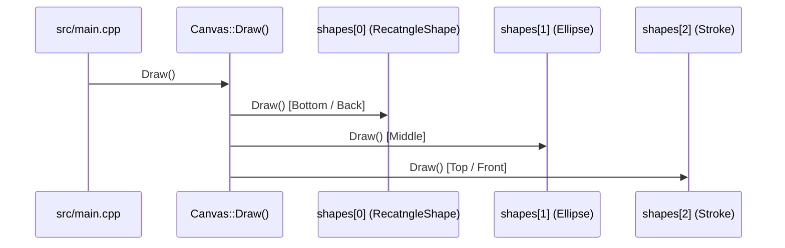

# Canvas & Shape Storage Architecture

The `Canvas` class acts as the central document model and scene graph for Inkling. It maintains exclusive, polymorphic ownership of all user-committed drawing primitives using standard library smart pointers, orchestrates the frame-by-frame rendering pass according to painter's algorithm z-ordering, and exposes spatial hit-testing routines to identify which shape lies beneath a given coordinate. This document analyzes how shapes are stored, rendered, and queried, details the underlying memory model, and highlights crucial ownership semantics and z-order considerations.

## Related Files
- Interface: [include/Canvas.h](file:///home/subhani/Projects/Inkling/include/Canvas.h)
- Implementation: [src/Canvas.cpp](file:///home/subhani/Projects/Inkling/src/Canvas.cpp)
- Abstract Contract: [include/Shape.h](file:///home/subhani/Projects/Inkling/include/Shape.h)
- Usage in Main Loop: [src/main.cpp](file:///home/subhani/Projects/Inkling/src/main.cpp#L125-L145)

---

## 1. Storage & Ownership Model

In [include/Canvas.h](file:///home/subhani/Projects/Inkling/include/Canvas.h#L13), shapes are stored in a single private contiguous container:

```cpp
private:
  std::vector<std::unique_ptr<Shape>> shapes;
```

### 1.1 Exclusive Ownership via `std::unique_ptr`
Inkling adopts modern C++ RAII (Resource Acquisition Is Initialization) idioms:
- `Canvas` maintains **exclusive ownership** over every committed shape. A shape cannot be shared or simultaneously owned by multiple containers.
- When a shape is added to the canvas in [src/Canvas.cpp](file:///home/subhani/Projects/Inkling/src/Canvas.cpp#L2):
  ```cpp
  void Canvas::Add(std::unique_ptr<Shape> s) { 
    shapes.push_back(std::move(s)); 
  }
  ```
  The caller must transfer ownership using `std::move`. The canvas assumes full lifecycle management.
- When the `Canvas` instance goes out of scope or is destroyed, the vector's destructor automatically invokes `std::unique_ptr` destructors for every element, deallocating the heap memory of each derived shape.

### 1.2 The Role of `virtual ~Shape() = default;`
Polymorphic storage in `std::unique_ptr<Shape>` requires that `Shape` declare a virtual destructor in [include/Shape.h](file:///home/subhani/Projects/Inkling/include/Shape.h#L6):

```cpp
virtual ~Shape() = default;
```

If the base class destructor were non-virtual, invoking `delete` on a `Shape*` pointing to a derived object (such as `Stroke`) would result in undefined behavior under the C++ standard (`[class.cdtor]`). Specifically:
- Only `~Shape()` would run.
- The derived class destructor `~Stroke()` would be skipped.
- Any dynamically allocated resources held by derived members—such as `Stroke`'s underlying heap-allocated point buffer in `std::vector<Vector2> points`—would leak.

---

## 2. Rendering & Z-Ordering

Canvas rendering is executed once per frame within the application's render pass in [src/Canvas.cpp](file:///home/subhani/Projects/Inkling/src/Canvas.cpp#L3-L6):

```cpp
void Canvas::Draw() const {
  for (const auto &s : shapes)
    s->Draw();
}
```

### 2.1 The Painter's Algorithm
The rendering loop relies on the standard **Painter's Algorithm**:
1. It iterates sequentially from index `0` to index `shapes.size() - 1`.
2. Shape `0` (the oldest committed shape) is drawn first onto the raylib frame buffer.
3. Subsequent shapes are drawn on top of earlier shapes.
4. The most recently added shape (`shapes.back()`) is drawn last, rendering over any overlapping geometry.

### 2.2 Dynamic Dispatch via Vtable
Because `shapes` stores `std::unique_ptr<Shape>`, the call `s->Draw()` is dynamically dispatched:
1. The program dereferences `s.get()`.
2. It fetches the object's virtual table pointer (`vptr`).
3. It indexes the `Draw` slot in the vtable.
4. It executes the specific concrete implementation (`RecatngleShape::Draw`, `Ellipse::Draw`, `Diamond::Draw`, or `Stroke::Draw`).



---

## 3. Shape Picking (`PickAt`)

When the user clicks on the canvas, [src/main.cpp](file:///home/subhani/Projects/Inkling/src/main.cpp#L98) invokes `Canvas::PickAt`:

```cpp
Shape *Clicked = canvas.PickAt(GetMousePosition());
```

The implementation in [src/Canvas.cpp](file:///home/subhani/Projects/Inkling/src/Canvas.cpp#L7-L13) is:

```cpp
Shape *Canvas::PickAt(Vector2 p) const {
  for (auto &x : shapes) {
    if (x->Contains(p))
      return x.get();
  }
  return nullptr;
}
```

### 3.1 Return Value Semantics
- Returns a non-owning raw pointer (`Shape*`) to the matching shape.
- If no shape contains point `p`, it returns `nullptr`.
- The caller receives observation/access rights without taking ownership away from `Canvas`.

### 3.2 Critical Finding: Topmost vs. Bottommost Picking Order
There is an important divergence between user expectation and the current code:
- **Visual Stacking Order**: As established in Section 2, shapes at higher indices are drawn *on top* of shapes at lower indices.
- **Current Traversal Order**: `PickAt` iterates using a forward range-based for loop: `for (auto &x : shapes)`.
- **Result**: If two shapes overlap at point `p`, `PickAt` encounters and returns the shape at the **lowest index** (the bottommost shape in the z-stack), rather than the topmost visible shape!

```
Z-Index 2 (Top):    [ Circle ]      <-- User visually clicks here
Z-Index 1 (Bottom): [ Rectangle ]   <-- PickAt currently returns this!
```

#### Corrective Fix
To conform to standard Excalidraw / graphic editor behavior, `PickAt` should walk backwards from the topmost shape to the bottommost shape using reverse iterators:

```cpp
Shape *Canvas::PickAt(Vector2 p) const {
  for (auto it = shapes.rbegin(); it != shapes.rend(); ++it) {
    if ((*it)->Contains(p))
      return it->get();
  }
  return nullptr;
}
```
*(See [docs/08-known-issues-and-todo.md](08-known-issues-and-todo.md) for full tracking).*

---

## 4. Ownership Risks & API Limitations

1. **Dangling Pointer Risk on Raw `Shape*`**:
   `PickAt` returns `Shape*`. If `Canvas` ever implements shape deletion (`DeleteShape`), clearing (`Clear()`), or reordering, any external pointer stored by the application will dangle if the referenced shape is destroyed.
2. **Const Correctness Leak**:
   `Canvas::PickAt` is declared `const`:
   ```cpp
   Shape *PickAt(Vector2 p) const;
   ```
   Even though the canvas itself cannot be modified by a `const` member function, returning a non-const raw pointer (`Shape*`) allows the caller to mutate internal shape state. If read-only inspection is intended, `const Shape *PickAt(...) const` should be provided, or explicit non-const and const overloads should be declared.
3. **Absence of Mutation APIs**:
   `Canvas` currently has no API to:
   - Remove a shape by ID or pointer.
   - Clear all shapes.
   - Reorder shapes in the z-stack (e.g., "Bring to Front" or "Send to Back").
   - Query the total shape count (`size()`).

---

## Assumptions / Unclear
- It is assumed that future selection and transformation workflows will require `Canvas` to expose shape removal and re-ordering operations, at which point returning raw `Shape*` will need careful lifetime guarantees or an ID-based lookup mechanism (`GetShapeById(int id)`).
