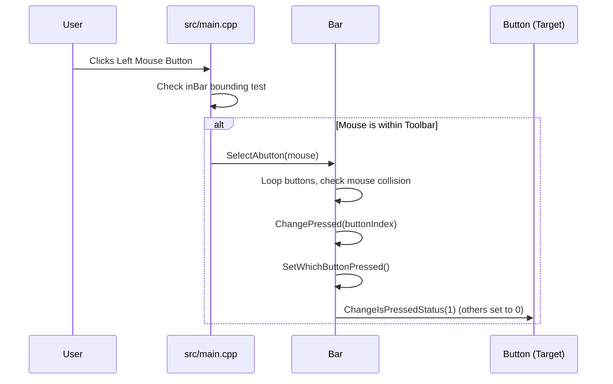

# Toolbar, Bar & Buttons Architecture

The user interface of Inkling features a vertical floating toolbar modeled after Excalidraw's iconic aesthetic. Implemented via the `Bar` and `Button` classes, the toolbar provides an interactive control panel supporting animated hover/selection states, bilinear-filtered icon textures, shortcut indicators, collision-free typographic layouts, and contextual tooltips. This document explains how the toolbar and its buttons are engineered, how state transitions and layout geometry are computed, and catalogs all configurable design tokens in `ToolbarConfig`.

## Related Files
- Toolbar Container: [include/Bar.h](file:///home/subhani/Projects/Inkling/include/Bar.h), [src/bar.cpp](file:///home/subhani/Projects/Inkling/src/bar.cpp)
- Button Component: [include/Button.h](file:///home/subhani/Projects/Inkling/include/Button.h), [src/Button.cpp](file:///home/subhani/Projects/Inkling/src/Button.cpp)
- Texture Manager: [include/Icons.h](file:///home/subhani/Projects/Inkling/include/Icons.h), [src/Icons.cpp](file:///home/subhani/Projects/Inkling/src/Icons.cpp)
- Layout Integration: [src/main.cpp](file:///home/subhani/Projects/Inkling/src/main.cpp#L36-L74)
- Engineering Design Notes: [docs/TOOLBAR_TUNING.md](file:///home/subhani/Projects/Inkling/docs/TOOLBAR_TUNING.md)

---

## 1. UI Hierarchy & Architecture

Both `Bar` and `Button` inherit from `BoundedShape`, granting them an axis-aligned bounding box (`bound`) and basic geometric properties. However, unlike canvas primitives, they are dedicated UI components managed by the application loop in `src/main.cpp`.

```mermaid
classDiagram
    BoundedShape <|-- Bar
    BoundedShape <|-- Button
    Bar *-- Button : owns std::vector~std::unique_ptr~Button~~
```

- `Bar` owns a vector of buttons: `std::vector<std::unique_ptr<Button>> allButtons`.
- `Bar` maintains tool selection via `int pressed` (stores current `Tool` enum index).
- Event handling is delegated: `Bar::UpdateState` forwards hover coordinates to child buttons, and `Bar::SelectAbutton` handles click selection.

---

## 2. Geometry, Spacing & Layout Mathematics

Layout parameters are centralized as CSS-like compile-time tokens in namespace `ToolbarConfig` ([include/Bar.h](file:///home/subhani/Projects/Inkling/include/Bar.h#L8-L67)).

### 2.1 Dimensions and Slot Pitch
- **Button Dimension (`TOOL_BTN_SIZE`)**: $44.0\text{ px} \times 44.0\text{ px}$.
- **Container Padding (`TOOLBAR_PADDING`)**: $8.0\text{ px}$.
- **Inter-Button Gap (`TOOL_GAP`)**: $9.0\text{ px}$ in [include/Bar.h](file:///home/subhani/Projects/Inkling/include/Bar.h#L23).
- **Slot Pitch**: $\text{Button Height} + \text{Gap} = 44.0\text{ px} + 9.0\text{ px} = 53.0\text{ px}$.

In [src/bar.cpp](file:///home/subhani/Projects/Inkling/src/bar.cpp#L52-L70), `Bar::LayoutUpdate()` dynamically recalculates container dimensions based on the button count $N$ (where $N = 11$):

$$\text{bound.width} = (2 \times \text{TOOLBAR\_PADDING}) + \text{TOOL\_BTN\_SIZE} = (2 \times 8) + 44 = 60.0\text{ px}$$

$$\text{bound.height} = (N \times \text{btnH}) + ((N - 1) \times \text{gap}) + (2 \times \text{pad})$$

For $N = 11$:
$$\text{bound.height} = (11 \times 44) + (10 \times 9) + (2 \times 8) = 484 + 90 + 16 = 590.0\text{ px}$$

### 2.2 Corner Roundness (Raylib Normalized Ratio)
Raylib’s `DrawRectangleRounded` requires a normalized roundness ratio $R \in [0.0, 1.0]$:

$$R = \frac{\text{target radius}}{\min(\text{width}, \text{height}) / 2}$$

- **Toolbar Container**:
  $$\text{roundness}_{\text{bar}} = \frac{\text{TOOLBAR\_RADIUS}}{\text{width} / 2} = \frac{14.0}{60.0 / 2} = \frac{14.0}{30.0} \approx 0.4667$$
- **Button**:
  $$\text{roundness}_{\text{btn}} = \frac{\text{TOOL\_BTN\_RADIUS}}{\text{width} / 2} = \frac{10.0}{44.0 / 2} = \frac{10.0}{22.0} \approx 0.4545$$

### 2.3 Window Offsets and Dynamic Vertical Centering
- **Horizontal Placement**: Positioned at a fixed offset `TOOLBAR_LEFT = 16.0f` from the left window border.
- **Vertical Centering**: Every frame in [src/main.cpp](file:///home/subhani/Projects/Inkling/src/main.cpp#L66-L73), the bar checks window dimensions to remain vertically centered:
  ```cpp
  float currentCanvasTop = ToolbarConfig::TOP_BAR_HEIGHT;
  float currentCanvasHeight = (float)GetScreenHeight() - currentCanvasTop;
  float targetBarY = currentCanvasTop + (currentCanvasHeight - MainBar.GetDimension().y) / 2.0f;
  if (MainBar.GetOrigin().y != targetBarY || MainBar.GetOrigin().x != ToolbarConfig::TOOLBAR_LEFT) {
    MainBar.SetPosition(Vector2{ToolbarConfig::TOOLBAR_LEFT, targetBarY});
  }
  ```

---

## 3. Visual Styling & Color Tokens

Inkling uses an Excalidraw-inspired dark color palette:

| Element | State | RGBA Value | Hex / Description |
| :--- | :--- | :--- | :--- |
| **Toolbar Container** | Background | `rgba(35, 35, 41, 255)` | Dark charcoal container background |
| | Border | `rgba(55, 55, 65, 255)` | 1px subtle outline |
| | Shadow | `rgba(0, 0, 0, 45)` | Soft drop shadow offset by $(x-1, y+2, w+2, h+4)$ |
| **Button Background** | Idle | `rgba(35, 35, 41, 0)` | Transparent (blends into container) |
| | Hover | `rgba(255, 255, 255, 20)` | ~8% translucent white |
| | Active / Selected | `rgba(64, 62, 106, 255)` | `#403e6a` (Excalidraw purple) |
| | Active + Hover | `rgba(74, 72, 118, 255)` | Lightened purple |
| **Icon Tint** | Idle | `rgba(210, 210, 216, 255)` | Soft white |
| | Hover | `rgba(255, 255, 255, 255)` | Pure bright white |
| | Active | `rgba(215, 212, 250, 255)` | Soft lavender tint |
| **Shortcut Label** | Idle | `rgba(255, 255, 255, 166)` | 65% opacity white |
| | Hover | `rgba(255, 255, 255, 204)` | 80% opacity white |
| | Active | `rgba(255, 255, 255, 242)` | 95% opacity white |

---

## 4. Animation & State Transitions

Button state transitions do not snap instantaneously; they interpolate smoothly using linear interpolation (`LerpColor`) over a 120ms duration (`TRANSITION_TIME = 0.120f`).

In [src/Button.cpp](file:///home/subhani/Projects/Inkling/src/Button.cpp#L76-L92):
```cpp
void Button::isHovered(Vector2 mousePos) {
  onHover = CheckCollisionPointRec(mousePos, bound);

  float dt = GetFrameTime();
  if (dt <= 0.0f || dt > 0.1f) dt = 1.0f / 60.0f;
  float speed = dt / ToolbarConfig::TRANSITION_TIME; // 120ms duration

  if (onHover)
    hoverProgress = std::min(1.0f, hoverProgress + speed);
  else
    hoverProgress = std::max(0.0f, hoverProgress - speed);

  if (isPressed)
    activeProgress = std::min(1.0f, activeProgress + speed);
  else
    activeProgress = std::max(0.0f, activeProgress - speed);
}
```

During rendering ([src/Button.cpp](file:///home/subhani/Projects/Inkling/src/Button.cpp#L22-L73)), `currentBg`, `currentIconColor`, and `currentTextColor` are computed by evaluating `LerpColor` against `hoverProgress` and `activeProgress`.

---

## 5. Icon Loading & Collision-Free Typography

### 5.1 Icon Asset Management
Icons are loaded via the RAII `Icons` class in [src/Icons.cpp](file:///home/subhani/Projects/Inkling/src/Icons.cpp):
1. Loads 11 high-resolution $96 \times 96$ PNG textures from `assets/icons/*.png`.
2. Sets bilinear filtering: `SetTextureFilter(t, TEXTURE_FILTER_BILINEAR)`.
3. Passes texture handles to individual buttons: `btn->SetIcon(icons.Get(i));`.
4. Renders icons into a $22.0\text{ px} \times 22.0\text{ px}$ destination box using `DrawTexturePro`.

### 5.2 Shortcut Typography & Anti-Collision Offset
To display single-key keyboard shortcuts without obstructing the icon graphic:
- **Shortcut Font Size (`TOOL_LABEL_SIZE`)**: $11.0\text{ px}$.
- **Label Placement**: Positioned at bottom-right of button:
  $$tx = \text{bound.x} + \text{bound.width} - \text{textW} - \text{TOOL\_LABEL\_RIGHT} \quad (\text{right: 5px})$$
  $$ty = \text{bound.y} + \text{bound.height} - \text{fontSize} - \text{TOOL\_LABEL\_BOTTOM} \quad (\text{bottom: 3px})$$
- **Icon Vertical Shift (`TOOL_ICON_OFFSET_Y = -2.0f`)**:
  The icon is shifted upward by $2\text{ px}$ (`translateY(-2px)`):
  $$\text{dest.y} = \text{bound.y} + \frac{44 - 22}{2} - 2 = \text{bound.y} + 9.0\text{ px}$$
  Because icon glyphs occupy $Y \in [9.0, 29.2]\text{ px}$ and the label occupies $Y \in [30.0, 41.0]\text{ px}$, this offset guarantees positive vertical clearance and prevents visual collision across all 11 icons.

---

## 6. Button Tooltips

When a button is hovered and possesses a non-empty tooltip string:
- `Bar::Draw()` renders an overlay tooltip box to the right of the toolbar container ([src/bar.cpp](file:///home/subhani/Projects/Inkling/src/bar.cpp#L32-L49)).
- Position:
  $$ttX = \text{bound.x} + \text{bound.width} + 10.0\text{ px}$$
  $$ttY = \text{item->GetOrigin().y} + \frac{\text{item->getheight()} - ttHeight}{2.0\text{ px}}$$
- Styled with a dark rounded box (`rgba(24, 24, 28, 245)`), 1px border (`rgba(55, 55, 65, 255)`), and crisp text (`rgba(240, 240, 245, 255)`).

---

## 7. Tool Tracking & Button Selection Flow



1. In [src/main.cpp](file:///home/subhani/Projects/Inkling/src/main.cpp#L106-L112), `inBar` determines whether the click was inside the toolbar bounds.
2. If `inBar` is true, `MainBar.SelectAbutton(mouse)` is invoked.
3. `SelectAbutton` identifies the button under the cursor and calls `ChangePressed(i)`.
4. `ChangePressed` updates `pressed = val` and calls `SetWhichButtonPressed()`.
5. `SetWhichButtonPressed` marks the chosen button `isPressed = 1` and resets all other buttons to `0`.
6. On subsequent frames, `isHovered()` advances `activeProgress` towards `1.0f` to animate the purple selection background.

---

## 8. Styling Configuration Reference (`ToolbarConfig`)

All layout, typography, and animation tokens are defined in [include/Bar.h](file:///home/subhani/Projects/Inkling/include/Bar.h#L8-L67):

| Token | Type | Current Value | Purpose / Effect |
| :--- | :--- | :--- | :--- |
| `TOOL_BTN_SIZE` | `float` | `44.0f` | Button width and height ($44 \times 44\text{ px}$). |
| `TOOL_BTN_RADIUS` | `float` | `10.0f` | Corner radius of tool buttons ($10\text{ px}$). |
| `TOOL_GAP` | `float` | `9.0f` | Vertical gap between adjacent buttons ($9\text{ px}$). |
| `TOOLBAR_PADDING` | `float` | `8.0f` | Padding inside the toolbar container ($8\text{ px}$). |
| `TOOLBAR_RADIUS` | `float` | `14.0f` | Corner radius of the toolbar container ($14\text{ px}$). |
| `TOOLBAR_LEFT` | `float` | `16.0f` | Distance from window left edge to toolbar ($16\text{ px}$). |
| `TOOL_ICON_SIZE` | `float` | `22.0f` | Rendered width and height of icon glyphs ($22\text{ px}$). |
| `TOOL_ICON_OFFSET_Y` | `float` | `-2.0f` | Vertical icon translation to clear shortcut label. |
| `TOOL_LABEL_SIZE` | `float` | `11.0f` | Font size for shortcut labels ($11\text{ px}$). |
| `TOOL_LABEL_BOTTOM` | `float` | `3.0f` | Bottom offset for shortcut label ($3\text{ px}$). |
| `TOOL_LABEL_RIGHT` | `float` | `5.0f` | Right offset for shortcut label ($5\text{ px}$). |
| `TOOL_LABEL_OPACITY_INACTIVE` | `float` | `0.65f` | Label alpha multiplier on inactive buttons ($65\%$). |
| `TOOL_LABEL_OPACITY_ACTIVE` | `float` | `0.95f` | Label alpha multiplier on active buttons ($95\%$). |
| `TOP_BAR_HEIGHT` | `float` | `0.0f` | Height reserved for top status/selection bar ($0\text{ px}$). |
| `TRANSITION_TIME` | `float` | `0.120f` | Duration of hover and active color lerps ($120\text{ ms}$). |

---

## Assumptions / Unclear
- `TOOLBAR_TUNING.md` documents a $6.0\text{ px}$ `TOOL_GAP` and $560\text{ px}$ total height from a previous tuning pass, whereas the actual codebase in `include/Bar.h` specifies `constexpr float TOOL_GAP = 9.0f;`, yielding a $590\text{ px}$ height. The actual code values are reflected in this document.
