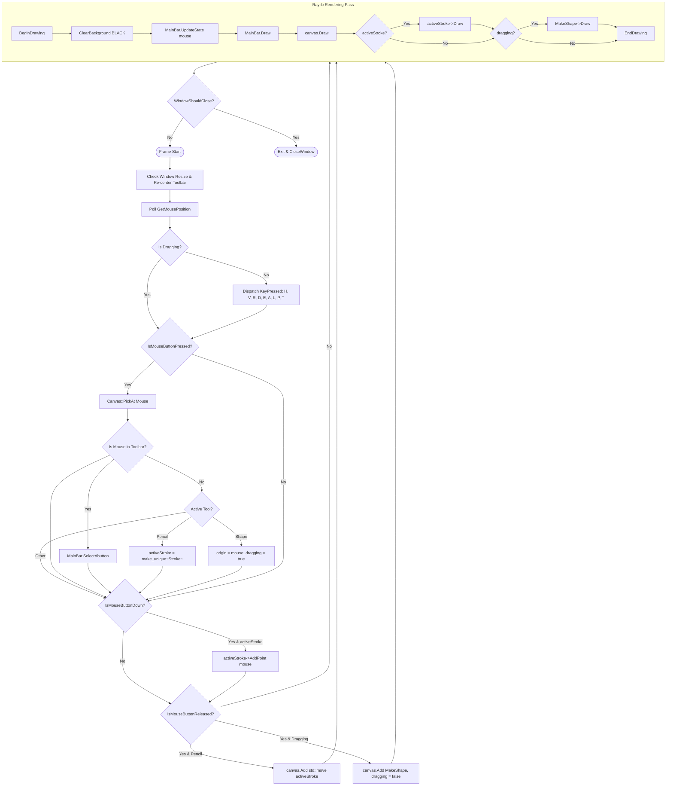

# Tools & Input Handling Architecture

The interaction loop in Inkling coordinates user input (mouse coordinates, clicks, drags, and keyboard shortcuts), maintains tool state, provides real-time shape creation previews, and dispatches committed shapes to the canvas. This document details the tool enumeration, the frame-by-frame state machine in `src/main.cpp`, how coordinate normalization guarantees positive bounding geometry, and the mechanics of live previews.

## Related Files
- Event Loop & Main Entry: [src/main.cpp](file:///home/subhani/Projects/Inkling/src/main.cpp)
- Tool Definitions: [include/Tool.h](file:///home/subhani/Projects/Inkling/include/Tool.h), [src/Tool.cpp](file:///home/subhani/Projects/Inkling/src/Tool.cpp)
- Factory Functions: [include/ShapeFactory.h](file:///home/subhani/Projects/Inkling/include/ShapeFactory.h), [src/ShapeFactory.cpp](file:///home/subhani/Projects/Inkling/src/ShapeFactory.cpp)
- Freehand Stroke Logic: [include/Stroke.h](file:///home/subhani/Projects/Inkling/include/Stroke.h), [src/Stroke.cpp](file:///home/subhani/Projects/Inkling/src/Stroke.cpp)
- Bounding Normalization: [include/BoundedShape.h](file:///home/subhani/Projects/Inkling/include/BoundedShape.h), [src/BoundedShape.cpp](file:///home/subhani/Projects/Inkling/src/BoundedShape.cpp)

---

## 1. Tool Catalog & Capabilities

In [include/Tool.h](file:///home/subhani/Projects/Inkling/include/Tool.h#L3-L15), the available tools are defined via `enum Tool`:

```cpp
enum Tool {
  TOOL_HAND,    // 0
  TOOL_SELECT,  // 1
  TOOL_RECT,    // 2
  TOOL_DIAMOND, // 3
  TOOL_ELLIPSE, // 4
  TOOL_ARROW,   // 5
  TOOL_LINE,    // 6
  TOOL_PENCIL,  // 7
  TOOL_TEXT,    // 8
  TOOL_TWINKLE, // 9
  TOOL_ERASER   // 10
};
```

### Tool Status & Mapping Table

| Index | Tool Enum | Shortcut | Tooltip | Active Handler in `main.cpp` | Status |
| :---: | :--- | :---: | :--- | :--- | :--- |
| **0** | `TOOL_HAND` | `H` | `"Hand - H"` | None | **Inert** (No panning yet) |
| **1** | `TOOL_SELECT` | `V` | `"Select - V"` | Hits logged via `TraceLog` | **Partial** (Hit test only, no selection state) |
| **2** | `TOOL_RECT` | `R` | `"Rectangle - R"` | `ToolToShape` $\rightarrow$ `ShapeType::Rect` | **Functional** (Creates `RecatngleShape`) |
| **3** | `TOOL_DIAMOND` | `D` | `"Diamond - D"` | `ToolToShape` $\rightarrow$ `ShapeType::Diamond` | **Functional** (Creates `Diamond`) |
| **4** | `TOOL_ELLIPSE` | `O` | `"Ellipse - O"` | `ToolToShape` $\rightarrow$ `ShapeType::Ellipse` | **Functional** (Creates `Ellipse`) |
| **5** | `TOOL_ARROW` | `A` | `"Arrow - A"` | None | **Inert** (Shape not implemented) |
| **6** | `TOOL_LINE` | `L` | `"Line - L"` | None | **Inert** (Shape not implemented) |
| **7** | `TOOL_PENCIL` | `P` | `"Draw - P"` | Allocates & collects `Stroke` | **Functional** (Creates `Stroke`) |
| **8** | `TOOL_TEXT` | `T` | `"Text - T"` | None | **Inert** (Text not implemented) |
| **9** | `TOOL_TWINKLE` | `K` | `"Magic wand - K"`| None | **Inert** (AI/Magic tool placeholder) |
| **10**| `TOOL_ERASER` | `E` | `"Eraser - E"` | None | **Inert** (Eraser not implemented) |

---

## 2. Keyboard Shortcut Dispatch & Inconsistencies

Keyboard input is processed in [src/main.cpp](file:///home/subhani/Projects/Inkling/src/main.cpp#L76-L95). A guard prevents tool switching while an active mouse drag is in progress (`if (!dragging)`).

```cpp
if (!dragging) { // don't switch tools mid-drag
  if (IsKeyPressed(KEY_H)) MainBar.ChangePressed(TOOL_HAND);
  if (IsKeyPressed(KEY_V)) MainBar.ChangePressed(TOOL_SELECT);
  if (IsKeyPressed(KEY_R)) MainBar.ChangePressed(TOOL_RECT);
  if (IsKeyPressed(KEY_D)) MainBar.ChangePressed(TOOL_DIAMOND);
  if (IsKeyPressed(KEY_E)) MainBar.ChangePressed(TOOL_ELLIPSE); // Collision!
  if (IsKeyPressed(KEY_A)) MainBar.ChangePressed(TOOL_ARROW);
  if (IsKeyPressed(KEY_L)) MainBar.ChangePressed(TOOL_LINE);
  if (IsKeyPressed(KEY_P)) MainBar.ChangePressed(TOOL_PENCIL);
  if (IsKeyPressed(KEY_T)) MainBar.ChangePressed(TOOL_TEXT);
}
```

### Critical Input Discrepancies
1. **Shortcut Mismatch for Ellipse / Eraser**:
   - The UI button for Ellipse displays shortcut `"O"` (and tooltip `"Ellipse - O"`).
   - The UI button for Eraser displays shortcut `"E"` (and tooltip `"Eraser - E"`).
   - In code: `IsKeyPressed(KEY_E)` switches to `TOOL_ELLIPSE` instead of `TOOL_ERASER`.
   - `KEY_O` is never queried anywhere in `main.cpp`.
2. **Missing Key Handlers**:
   - `KEY_K` (Magic wand) is omitted from key polling.
   - `TOOL_ERASER` cannot be activated via keyboard.

---

## 3. Shape Creation Lifecycle: Press, Drag, Release

```mermaid
stateDiagram-v2
    [*] --> Idle

    Idle --> DraggingShape : MOUSE_LEFT pressed & ToolToShape is true
    Idle --> InkingStroke : MOUSE_LEFT pressed & Tool is TOOL_PENCIL
    Idle --> ButtonClick : MOUSE_LEFT pressed & inBar is true

    ButtonClick --> Idle : SelectAbutton updates active tool

    state DraggingShape {
        [*] --> UpdatePreview
        UpdatePreview --> UpdatePreview : Mouse moves (re-render temp shape)
    }
    DraggingShape --> Idle : MOUSE_LEFT released -> Canvas::Add(MakeShape(...))

    state InkingStroke {
        [*] --> CollectPoints
        CollectPoints --> CollectPoints : MOUSE_LEFT down -> Stroke::AddPoint(mouse)
    }
    InkingStroke --> Idle : MOUSE_LEFT released -> Canvas::Add(std::move(activeStroke))
```

### 3.1 Bounded Shapes (`Rect`, `Ellipse`, `Diamond`)
1. **Mouse Press (`IsMouseButtonPressed`)**:
   - Clicks outside the toolbar evaluate `ToolToShape(MainBar.GetPressed(), current)`.
   - If true, records `origin = mouse;` and sets `dragging = true;`.
2. **Mouse Drag (Render Loop)**:
   - While `dragging` is true, the frame renders a live preview:
     ```cpp
     MakeShape(current, origin, mouse)->Draw();
     ```
3. **Mouse Release (`IsMouseButtonReleased`)**:
   - Evaluates `canvas.Add(MakeShape(current, origin, mouse));`.
   - Transfers the newly allocated shape into `Canvas` and resets `dragging = false;`.

### 3.2 Freehand Pencil (`Stroke`)
1. **Mouse Press**:
   - If `MainBar.GetPressed() == TOOL_PENCIL`, allocates a new stroke:
     ```cpp
     activeStroke = std::make_unique<Stroke>();
     activeStroke->AddPoint(mouse);
     ```
2. **Mouse Hold (`IsMouseButtonDown`)**:
   - For every subsequent frame the left button is held, samples the cursor position:
     ```cpp
     if (activeStroke && IsMouseButtonDown(MOUSE_BUTTON_LEFT))
       activeStroke->AddPoint(mouse);
     ```
   - Renders live polyline: `if (activeStroke) activeStroke->Draw();`.
3. **Mouse Release**:
   - Commits the finished stroke to canvas via ownership transfer:
     ```cpp
     canvas.Add(std::move(activeStroke));
     ```

---

## 4. Coordinate Normalization (Handling Dragging Up or Left)

When users drag top-leftward, $mouse.x < origin.x$ and $mouse.y < origin.y$. A naive calculation would result in negative width and height, causing raylib rendering primitives to fail or misalign.

Inkling solves this inside `BoundedShape::SetCorners(Vector2 a, Vector2 b)` ([src/BoundedShape.cpp](file:///home/subhani/Projects/Inkling/src/BoundedShape.cpp#L8-L11)):

```cpp
void BoundedShape::SetCorners(Vector2 a, Vector2 b) {
  bound = {
    std::min(a.x, b.x), 
    std::min(a.y, b.y), 
    std::fabs(b.x - a.x),
    std::fabs(b.y - a.y)
  };
}
```

### Mathematical Invariants
- **Origin ($x, y$)**: Guaranteed to be the upper-leftmost point:
  $$x = \min(a.x, b.x), \quad y = \min(a.y, b.y)$$
- **Dimensions ($w, h$)**: Guaranteed strictly non-negative:
  $$w = |b.x - a.x| \ge 0, \quad h = |b.y - a.y| \ge 0$$

Because `MakeShape` passes `(origin, mouse)` to the constructor of `BoundedShape`, normalization happens automatically every single frame of a drag.

---

## 5. Live Preview Mechanics & Heap Allocation Analysis

In [src/main.cpp](file:///home/subhani/Projects/Inkling/src/main.cpp#L142-L143), the preview during dragging is rendered via:

```cpp
if (dragging)
  MakeShape(current, origin, mouse)->Draw(); // live preview
```

### Architectural Implications
1. **Temporary Object Churn**:
   - At 60 FPS, `MakeShape` invokes `std::make_unique<DerivedShape>(origin, mouse)` **60 times every second**.
   - The unique pointer is constructed, `Draw()` is called, and the object is immediately destroyed at the end of the full expression.
2. **Side Effect on `Shape::nextId`**:
   - Every `Shape` constructor increments the static ID counter `nextId++` ([src/Shape.cpp](file:///home/subhani/Projects/Inkling/src/Shape.cpp#L3)).
   - A 2-second mouse drag consumes $120$ unique shape IDs before committing just $1$ shape to the canvas.
   *(See [docs/08-known-issues-and-todo.md](08-known-issues-and-todo.md) for proposed lightweight preview architectures).*

---

## 6. The Per-Frame Flow Diagram

The complete frame lifecycle executed by `src/main.cpp` is modeled below:



---

## Assumptions / Unclear
- `IsMouseButtonPressed(MOUSE_BUTTON_LEFT)` triggers `canvas.PickAt()` unconditionally on line 98 of `main.cpp`, logging `"HIT"` or `"EMPty space "` even when the user clicks on a toolbar button.
- The `TOOL_SELECT` tool does not have an independent drag or interaction branch; it falls through to neither `activeStroke` nor `ToolToShape`.
