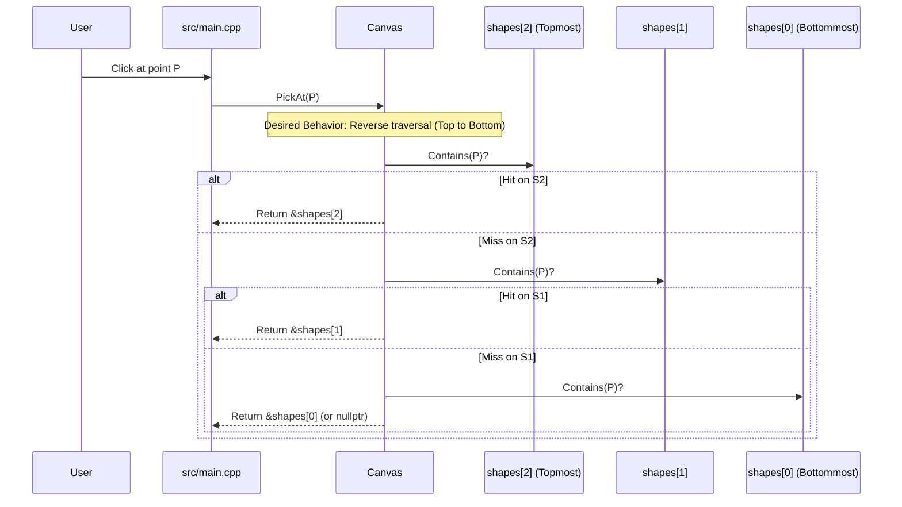

# Hit Testing & Mathematical Foundations

Hit testing is the geometric subsystem that determines whether a specific cursor position $(p.x, p.y)$ intersects a shape on the canvas. In Inkling, hit testing is formalized as a pure virtual member function in the base class (`virtual bool Contains(Vector2 p) const = 0;`), with tailored mathematical formulas implemented across all derived shapes. This document details the mathematical algorithms and code implementations for each shape type, explains the role of stroke tolerances, walks through numerical test cases, and analyzes how `Canvas::PickAt` coordinates hit resolution.

## Related Files
- Abstract Contract: [include/Shape.h](file:///home/subhani/Projects/Inkling/include/Shape.h)
- Bounding Box Default: [include/BoundedShape.h](file:///home/subhani/Projects/Inkling/include/BoundedShape.h), [src/BoundedShape.cpp](file:///home/subhani/Projects/Inkling/src/BoundedShape.cpp)
- Rectangle Override: [include/RectangleShape.h](file:///home/subhani/Projects/Inkling/include/RectangleShape.h), [src/RectangleShape.cpp](file:///home/subhani/Projects/Inkling/src/RectangleShape.cpp)
- Ellipse Math: [include/Ellipse.h](file:///home/subhani/Projects/Inkling/include/Ellipse.h), [src/Ellipse.cpp](file:///home/subhani/Projects/Inkling/src/Ellipse.cpp)
- Diamond Math: [include/Diamond.h](file:///home/subhani/Projects/Inkling/include/Diamond.h), [src/Diamond.cpp](file:///home/subhani/Projects/Inkling/src/Diamond.cpp)
- Polyline Stroke Math: [include/Stroke.h](file:///home/subhani/Projects/Inkling/include/Stroke.h), [src/Stroke.cpp](file:///home/subhani/Projects/Inkling/src/Stroke.cpp)
- Picker Scene Query: [include/Canvas.h](file:///home/subhani/Projects/Inkling/include/Canvas.h), [src/Canvas.cpp](file:///home/subhani/Projects/Inkling/src/Canvas.cpp)

---

## 1. The Hit-Testing Contract

In [include/Shape.h](file:///home/subhani/Projects/Inkling/include/Shape.h#L14):
```cpp
virtual bool Contains(Vector2 p) const = 0;
```
Every concrete shape must provide a geometric definition of its interior. `Contains` is declared `const`, guaranteeing that spatial queries never mutate shape state.

---

## 2. Geometric Algorithms by Shape

### 2.1 BoundedShape & RecatngleShape (Axis-Aligned Point-in-Rectangle)
In [src/BoundedShape.cpp](file:///home/subhani/Projects/Inkling/src/BoundedShape.cpp#L12-L14) and [src/RectangleShape.cpp](file:///home/subhani/Projects/Inkling/src/RectangleShape.cpp#L6-L8):

```cpp
bool BoundedShape::Contains(Vector2 p) const {
  return CheckCollisionPointRec(p, bound);
}
```

#### Mathematical Formulation
Given a bounding box defined by origin $(x_0, y_0)$ and positive dimensions $(w, h)$, point $P = (p.x, p.y)$ lies inside if and only if:

$$x_0 \le p.x \le x_0 + w \quad \land \quad y_0 \le p.y \le y_0 + h$$

Raylib's `CheckCollisionPointRec` evaluates these boundary inequalities.

#### Worked Numeric Example
- **Setup**: Rectangle with `bound = { x: 100.0f, y: 100.0f, width: 200.0f, height: 100.0f }`.
  - Valid Range: $X \in [100.0, 300.0]$, $Y \in [100.0, 200.0]$.
- **Test Point $P_1 = (150, 150)$**:
  - $100 \le 150 \le 300$ (True)
  - $100 \le 150 \le 200$ (True)
  - **Result**: `true` (Interior Hit).
- **Test Point $P_2 = (50, 150)$**:
  - $50 < 100$ (False)
  - **Result**: `false` (Miss outside left boundary).
- **Test Point $P_3 = (300, 200)$**:
  - Evaluates to `true` (Perimeter boundary hit).

---

### 2.2 Ellipse (Normalized Quadratic Algebraic Test)
In [src/Ellipse.cpp](file:///home/subhani/Projects/Inkling/src/Ellipse.cpp#L7-L16):

```cpp
bool Ellipse::Contains(Vector2 p) const {
  float radiiX = bound.width / 2;
  float radiiY = bound.height / 2;
  float dx = (p.x - (bound.x + radiiX)) / radiiX;
  float dy = (p.y - (bound.y + radiiY)) / radiiY;
  return dx * dx + dy * dy <= 1.0;
}
```

#### Mathematical Formulation
An axis-aligned ellipse centered at $(h, k)$ with semi-major/minor axes $r_x$ and $r_y$ is defined algebraically by:

$$\frac{(x - h)^2}{r_x^2} + \frac{(y - k)^2}{r_y^2} \le 1$$

To avoid division by squared floating-point numbers, Inkling computes normalized delta coordinates:
- Center: $h = bound.x + r_x, \quad k = bound.y + r_y$
- Semi-axes: $r_x = \frac{bound.width}{2}, \quad r_y = \frac{bound.height}{2}$
- Normalized Offsets:
  $$dx = \frac{p.x - h}{r_x}, \quad dy = \frac{p.y - k}{r_y}$$
- Test Condition:
  $$dx^2 + dy^2 \le 1.0$$

#### Why Overriding `BoundedShape::Contains` Matters
The corners of an ellipse's bounding box are outside the ellipse. A generic bounding-box hit test would produce false-positive hits in all four corners. The algebraic test filters these out.

#### Worked Numeric Example
- **Setup**: Ellipse inscribed in `bound = { x: 100.0f, y: 100.0f, width: 200.0f, height: 100.0f }`.
  - Semi-axes: $r_x = 100.0\text{ px}$, $r_y = 50.0\text{ px}$.
  - Center: $h = 100 + 100 = 200.0\text{ px}$, $k = 100 + 50 = 150.0\text{ px}$.
- **Test Point $P_1 = (200, 175)$ (Inside Ellipse)**:
  - $dx = \frac{200 - 200}{100} = 0.0$
  - $dy = \frac{175 - 150}{50} = \frac{25}{50} = 0.5$
  - $dx^2 + dy^2 = 0.0^2 + 0.5^2 = 0.25 \le 1.0$
  - **Result**: `true` (Hit).
- **Test Point $P_2 = (110, 110)$ (Inside Bounding Box Corner, Outside Ellipse)**:
  - Inside bounding box? Yes ($100 \le 110 \le 300$ and $100 \le 110 \le 200$).
  - $dx = \frac{110 - 200}{100} = \frac{-90}{100} = -0.9$
  - $dy = \frac{110 - 150}{50} = \frac{-40}{50} = -0.8$
  - $dx^2 + dy^2 = (-0.9)^2 + (-0.8)^2 = 0.81 + 0.64 = 1.45$
  - Since $1.45 > 1.0$, **Result**: `false` (Correctly rejected).

---

### 2.3 Diamond (Normalized Manhattan $L_1$ Distance Test)
In [src/Diamond.cpp](file:///home/subhani/Projects/Inkling/src/Diamond.cpp#L16-L24):

```cpp
bool Diamond::Contains(Vector2 p) const {
  float radiiX = bound.width / 2.0;
  float radiiY = bound.height / 2.0;
  float dx = std::fabsf(p.x - (bound.x + radiiX)) / radiiX;
  float dy = std::fabsf(p.y - (bound.y + radiiY)) / radiiY;
  return dx + dy <= 1.0;
}
```

#### Mathematical Formulation
A diamond formed by joining the midpoints of a rectangle is a rhombus. In a coordinate frame normalized by $(r_x, r_y)$, its boundary forms an $L_1$ norm unit ball (Manhattan circle):

$$\frac{|x - h|}{r_x} + \frac{|y - k|}{r_y} \le 1.0 \iff dx + dy \le 1.0$$

Any point where $dx + dy \le 1.0$ lies inside or on the edges of the diamond.

#### Worked Numeric Example
- **Setup**: Diamond inscribed in `bound = { x: 100.0f, y: 100.0f, width: 200.0f, height: 100.0f }`.
  - Center: $(h, k) = (200.0, 150.0)$, $r_x = 100.0$, $r_y = 50.0$.
- **Test Point $P_1 = (220, 160)$ (Inside Diamond)**:
  - $dx = \frac{|220 - 200|}{100} = \frac{20}{100} = 0.2$
  - $dy = \frac{|160 - 150|}{50} = \frac{10}{50} = 0.2$
  - $dx + dy = 0.2 + 0.2 = 0.4 \le 1.0$
  - **Result**: `true` (Hit).
- **Test Point $P_2 = (270, 185)$ (Corner Region)**:
  - Inside bounding box? Yes ($100 \le 270 \le 300$ and $100 \le 185 \le 200$).
  - $dx = \frac{|270 - 200|}{100} = \frac{70}{100} = 0.7$
  - $dy = \frac{|185 - 150|}{50} = \frac{35}{50} = 0.7$
  - $dx + dy = 0.7 + 0.7 = 1.4 > 1.0$
  - **Result**: `false` (Correctly rejected).

---

### 2.4 Stroke (Polyline Distance & Tolerance Buffer)
In [src/Stroke.cpp](file:///home/subhani/Projects/Inkling/src/Stroke.cpp#L9-L18):

```cpp
bool Stroke::Contains(Vector2 p) const {
  float tol = thickness / 2.0f + 4.0f;
  if (points.size() == 1)
    return CheckCollisionPointCircle(p, points[0], tol);
  for (size_t i = 1; i < points.size(); i++) {
    if (CheckCollisionPointLine(p, points[i - 1], points[i], int(tol)))
      return true;
  }
  return false;
}
```

#### What `tol` Means and Why it Exists
- **The Problem**: A freehand stroke is drawn as a polyline with a visual thickness of $2\text{ px}$. If hit testing required clicking exactly on the mathematical 1D line segments, selecting a stroke with a mouse cursor would require pixel-perfect precision and would fail on almost every user attempt.
- **The Solution**: A tolerance buffer `tol` expands the hit catchment zone around the stroke.
- **The Formula**:
  $$tol = \frac{\text{thickness}}{2.0\text{f}} + 4.0\text{f}$$
  For default `thickness = 2.0f`:
  $$tol = \frac{2.0}{2.0} + 4.0 = 5.0\text{ px}$$
- **Single Point**: If the stroke contains only 1 click dot, it tests collision with a circle of radius $tol = 5.0\text{ px}$ via `CheckCollisionPointCircle`.
- **Polyline Segments**: For multi-point paths, raylib's `CheckCollisionPointLine(p, p1, p2, int(tol))` computes the minimum Euclidean distance from $p$ to segment $\overline{p_1 p_2}$ and tests if $d \le int(tol)$.

#### Worked Numeric Example
- **Setup**: Stroke segment from $A = (100.0, 100.0)$ to $B = (200.0, 100.0)$ (horizontal segment, $Y = 100$).
  - $thickness = 2.0\text{f} \implies tol = 5.0\text{f} \implies int(tol) = 5$.
- **Test Point $P_1 = (150.0, 103.0)$**:
  - Perpendicular distance from $(150, 103)$ to line segment is $|103 - 100| = 3.0\text{ px}$.
  - $3.0 \le 5$ (Within tolerance).
  - **Result**: `true` (Hit).
- **Test Point $P_2 = (150.0, 108.0)$**:
  - Distance is $|108 - 100| = 8.0\text{ px}$.
  - $8.0 > 5$ (Exceeds tolerance).
  - **Result**: `false` (Miss).

---

## 3. Topmost Scene Query: `Canvas::PickAt`

When the user clicks, `src/main.cpp` queries the canvas to determine if a shape was hit:



### Discrepancy Note in Current Implementation
As noted in [docs/02-canvas-and-shape-storage.md](02-canvas-and-shape-storage.md) and [docs/08-known-issues-and-todo.md](08-known-issues-and-todo.md):
- In [src/Canvas.cpp](file:///home/subhani/Projects/Inkling/src/Canvas.cpp#L7-L12), the current loop iterates forward (`for (auto &x : shapes)`).
- This returns the **bottommost** shape rather than the topmost.
- To pick the topmost visual shape, the loop must be reversed:
  ```cpp
  for (auto it = shapes.rbegin(); it != shapes.rend(); ++it) {
    if ((*it)->Contains(p))
      return it->get();
  }
  ```

---

## Assumptions / Unclear
- In `src/Ellipse.cpp` and `src/Diamond.cpp`, if a shape is created with zero width or zero height (e.g., clicking without dragging), `radiiX` or `radiiY` is `0.0f`, resulting in floating-point division by zero (`inf` or `nan`). Handling degenerate bounds requires an explicit guard (see [docs/08-known-issues-and-todo.md](08-known-issues-and-todo.md)).
